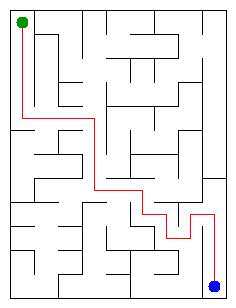

# Assignment 3. Maze Escape

Student ID: 250660
Name: Saparali Shalkar
Group: SE - 2532
Maze size (rows x columns): 12 x 9

## Program output

    Broken: 107
    Kept: 88
    Last broken wall: 153
    MST cost: 32144
    Heaviest broken wall: 793
    Path length: 21
    DFS visited: 72
    Dead ends: 30
    Zones: 108
    Largest zone: 1
    Is DAG: 1
    Flow stages: 19
    Fastest route cost: 6

My maze:

## Questions

### Mission 0

`find` returns the representative of the set that contains a cell. `union` joins two different sets and returns false when both cells are already in the same set. Path compression shortens the route to the root, and union by size attaches the smaller tree under the larger one.

### Mission 1

The maze has `R*C` cells, and a connected tree on that many vertices has exactly `R*C - 1` edges, so this many walls are broken. A rectangular grid has `R*(C-1) + C*(R-1)` inner walls; after subtracting the broken walls, the number left is `(R-1)*(C-1)`.

### Mission 2

Kruskal MST cost: 32144. Prim MST cost: 32144. They are equal because both algorithms construct a minimum spanning tree of the same connected weighted graph, although they choose edges in a different order.

### Mission 3

There is exactly one path between any two cells because the open doors form a tree: it is connected and has no cycles. I used an explicit array as a DFS stack instead of recursive calls, so a very large maze does not overflow the Java call stack.

### Mission 4

The first pass records finishing order. In the second pass, reversing every slide lets one search collect exactly the cells of the current strongly connected component without crossing into a component that should be processed later. The slides are acyclic exactly when every component contains one cell, so the number of zones is equal to the number of cells.

### Mission 5

Kosaraju numbers the zones in topological order, so every edge between different zones goes from a smaller number to a larger one. Therefore, when a zone is processed, all routes into it are already known, and one pass is enough. After the zone graph is built, the pass costs `O(z + e)`, where `z` is the number of zones and `e` is the number of edges between them.

## AI use

ChatGPT was used to explain the algorithms, review the implementation and check the program with the supplied tests. The final code was read and tested before submission.

## Timing (Mission 7)

Milliseconds, 5 runs each, from `java -cp out Bench`.

| maze | Kruskal | Prim |
|---|---:|---:|
| 100 x 100 | 8 ms | 9 ms |
| 300 x 300 | 53 ms | 80 ms |
| 1000 x 1000 | 537 ms | 2026 ms |

The running time increases quickly as the number of cells and walls grows, which agrees with the `O(m log m)` estimates. On this run, Prim became noticeably slower on the largest maze because it handled many candidate walls in its priority queue.

## Complexity

`n` is the number of cells, `m` is the number of walls or slides, `z` is the number of zones, and `e` is the number of edges in the zone graph.

| algorithm | time | space | assumptions |
|---|---|---|---|
| DSU find and union | amortized `O(alpha(n))` | `O(n)` | path compression and union by size |
| Kruskal | `O(m log m)` | `O(n + m)` | walls are sorted by cost |
| Prim | `O(m log m)` | `O(n + m)` | binary priority queue |
| DFS | `O(n + m)` | `O(n + m)` | iterative stack and adjacency lists |
| Kosaraju | `O(n + m)` | `O(n + m)` | two iterative DFS passes |
| Route in the zone graph | expected `O(m + z + e)` | `O(z + e)` | hash map operations take expected constant time |

## Before you submit

- Check that `output/maze.png` is in the repository.
- Run `java tools/Check.java` and confirm that all examples are right.
- Push the work to the public repository on the `main` branch with at least one commit per mission.
- Attach the public repository link in Moodle.
